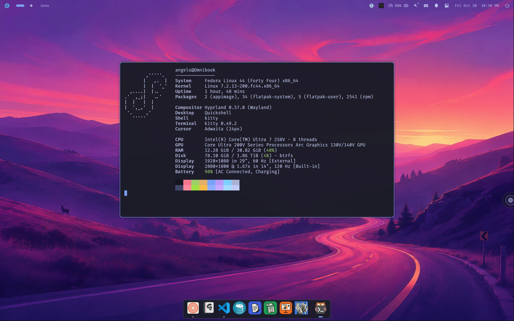
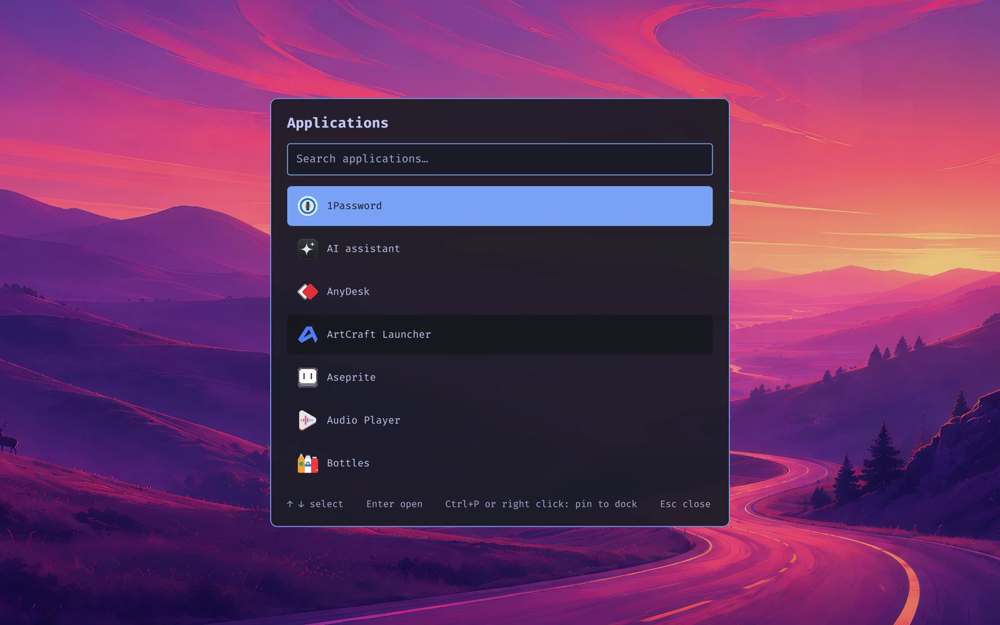
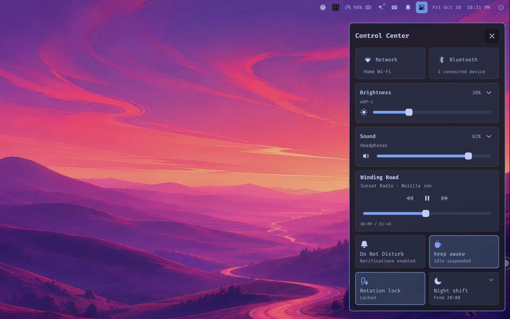
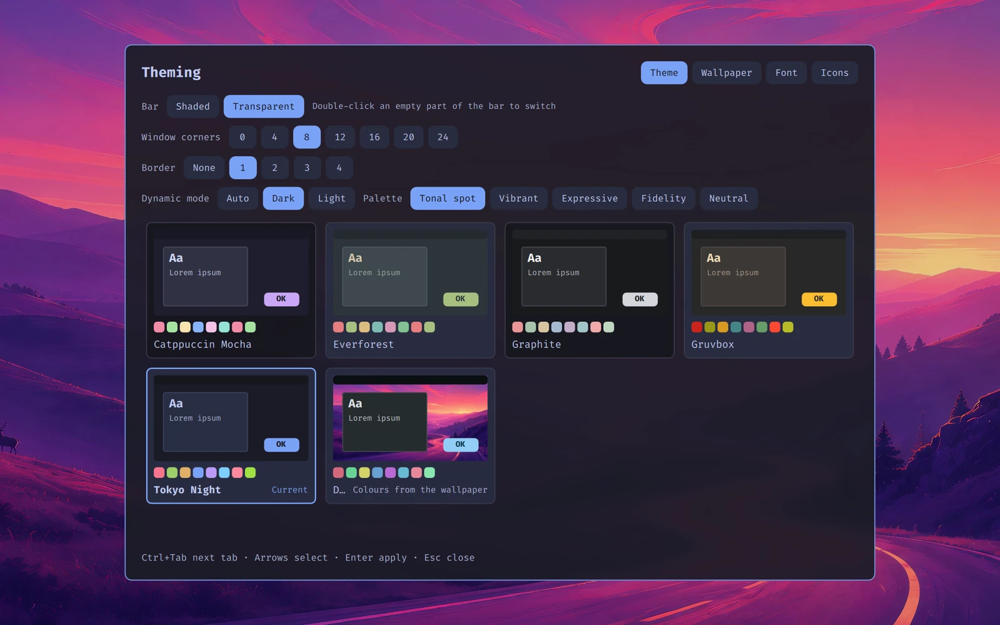
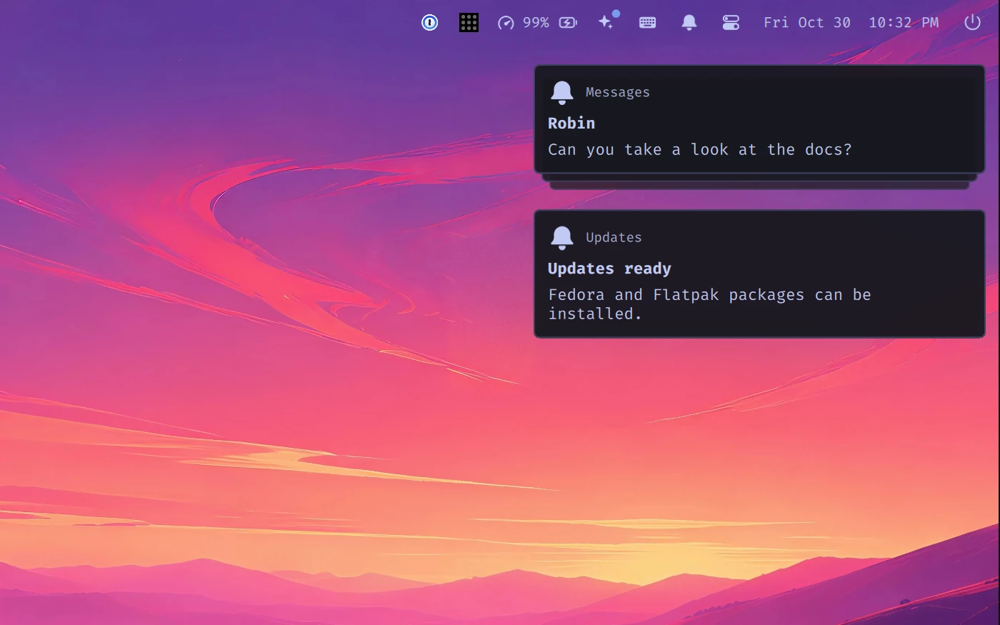
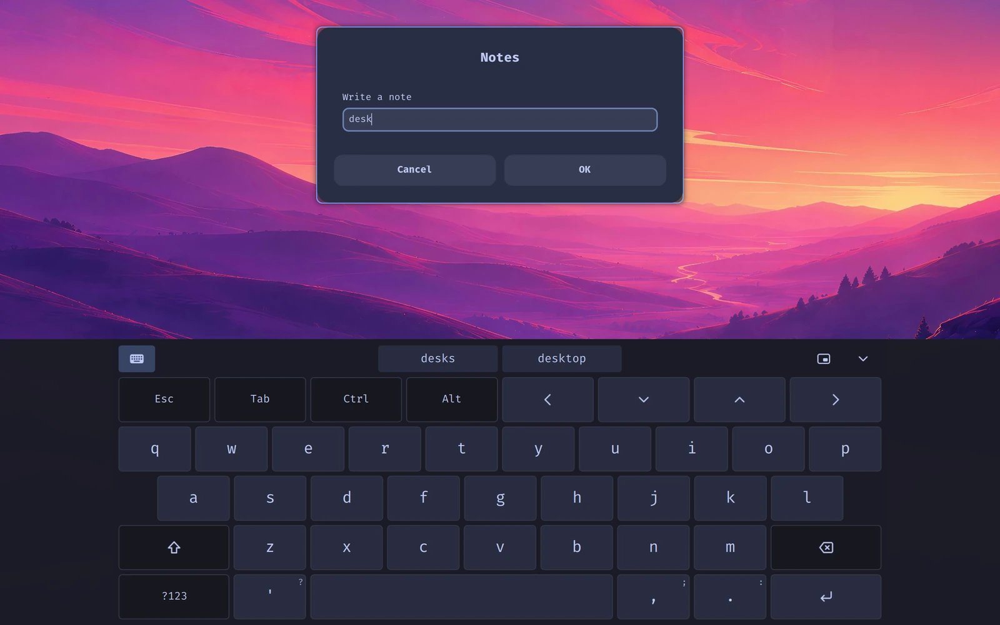
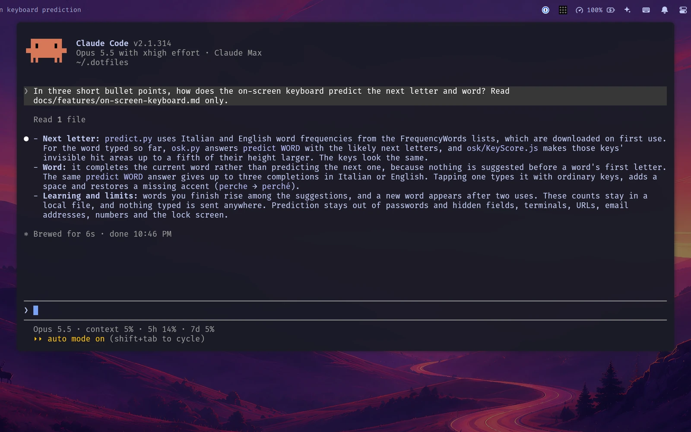

<h1 align="center">Hyprland + Quickshell</h1>

<p align="center">
  A complete Fedora desktop for a 2-in-1 laptop: every panel hand-written in Quickshell,<br>
  Hyprland configured in Lua, and a tablet mode that actually feels like one.
</p>

<p align="center">
  
  
  
  
</p>

<p align="center">
  
</p>

## Highlights

- **One shell, no external applets.** Bar, launcher, Control Center, dock, notifications, calendar, clipboard, power menu, Polkit agent and screen-sharing picker are all [Quickshell](https://quickshell.org/) and share one design.
- **[A real tablet mode](docs/features/tablet-and-touch.md).** Fold the laptop and the shell grows its touch targets, the display follows the sensor, and gestures take over. Gesture touches never reach the app underneath, so a swipe over a video does not pause it.
- **[An on-screen keyboard written for this desktop](docs/features/on-screen-keyboard.md).** Slide between keys, hit likely letters more easily, tap word suggestions in Italian and English. It learns your words, and nothing you type leaves the machine.
- **[Themes that reach everything](docs/features/theming.md).** One click changes the shell, terminal, GTK and Qt apps, lock screen, wallpapers, fonts and icons. Five hand-made themes, plus a dynamic one drawn from your wallpaper.
- **[Notifications in decks](docs/features/notifications.md).** Popups stack per app, or per site for browsers, and open on hover or tap.
- **[Claude Code as part of the desktop](docs/features/ai-assistant.md).** A drop-down console, a state icon in the bar, usage meters and notifications when it needs you.
- **The small things.** Italian and English everywhere, Steam and gamescope launchers tuned for HiDPI, system updates in the bar, automounted drives, fingerprint unlock.

## Gallery

| | |
| --- | --- |
|  |  |
| **Launcher.** Search, icons and keyboard navigation. | **Control Center.** Network, audio, brightness, media and switches. |
|  |  |
| **Theming.** Themes, wallpapers, fonts and icons in one place. | **Notifications.** One deck per app, newest on top. |
|  |  |
| **On-screen keyboard.** Suggestions above the keys. | **AI console.** Claude Code dropping down from the bar, ready in this repository. |

All shots use the Tokyo Night theme with a wallpaper from [Omarchy](https://github.com/basecamp/omarchy).

## Getting started

> [!NOTE]
> This is a personal desktop, tuned for Fedora 44 and an HP OmniBook Ultra Flip. It should work on other hardware, with some settings to adjust, and other distributions are on the [roadmap](docs/development/roadmap.md).

Install the packages listed in the [installation guide](docs/guide/installation.md), then link the configuration:

```sh
git clone https://github.com/angelobdev/dotfiles ~/.dotfiles
cd ~/.dotfiles
./scripts/stow.py dry-run    # shows what would change
./scripts/stow.py apply      # backs up conflicts, then links
./scripts/check.sh
```

Do not run Stow with sudo. Everything is a symlink to this repository, so editing a file here changes the live desktop. [Hyprland plugins](docs/guide/plugins.md) are built separately.

## Documentation

- **[Guides](docs/README.md#guides):** installation, interface and shortcuts, configuration, plugins, integrations, troubleshooting.
- **[Features](docs/README.md#features):** one page for each area of the desktop.
- **[Development](docs/README.md#development):** architecture, conventions, workflow, roadmap and the verification log.

## Built with

[Hyprland](https://hypr.land/), [Quickshell](https://quickshell.org/) and GNU Stow, with [Hyprspace](https://github.com/KZDKM/Hyprspace), [Hyprgrass](https://github.com/horriblename/hyprgrass), [Hyprglass](https://github.com/hyprnux/hyprglass) and [HyprCapture](https://github.com/gfhdhytghd/HyprCapture). The default wallpaper is Fedora's night artwork ([CC-BY-SA-4.0](hyprpaper/.local/share/wallpapers/ATTRIBUTION.md)). Theme wallpapers come from [Omarchy](https://github.com/basecamp/omarchy) and community collections, and word lists from [FrequencyWords](https://github.com/hermitdave/FrequencyWords) (CC-BY-SA-4.0): both are fetched on demand and are not part of this repository.

Much of this desktop was built together with [Claude Code](https://claude.com/claude-code), and the [verification log](docs/development/verification-log.md) records what was tested and how.

## License

[MIT](LICENSE), except the bundled wallpaper, which keeps its [own license](hyprpaper/.local/share/wallpapers/LICENSE).
