<h1 align="center">Hyprland + Quickshell</h1>

<p align="center">
  A complete Fedora and Arch Linux desktop for a 2-in-1 laptop: every panel hand-written in Quickshell,<br>
  Hyprland configured in Lua, and a tablet mode that actually feels like one.
</p>

<p align="center">
  
  
  
  
  
  <a href="https://github.com/angelobdev/dotfiles/actions/workflows/check.yml"></a>
</p>

<p align="center">
  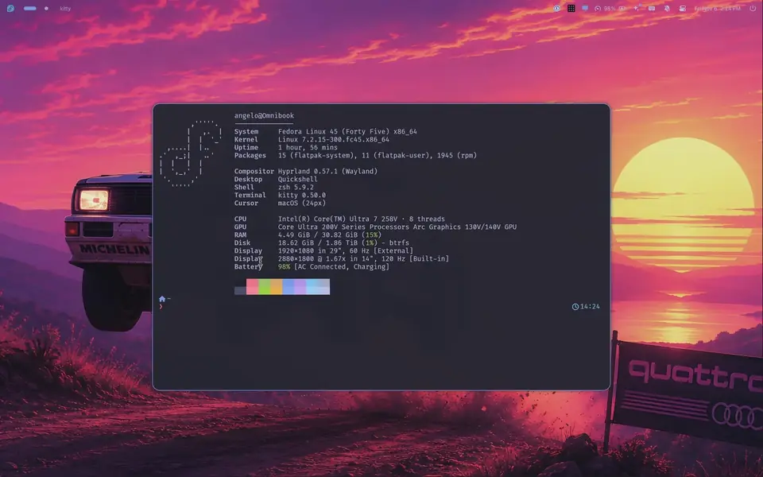
</p>

## Highlights

One shell, no external applets: bar, launcher, Control Center, dock, notifications, calendar, clipboard, power menu, Settings, Polkit agent and screen-sharing picker are all [Quickshell](https://quickshell.org/) and share one design.

### Settings for the whole desktop

<p align="center">
  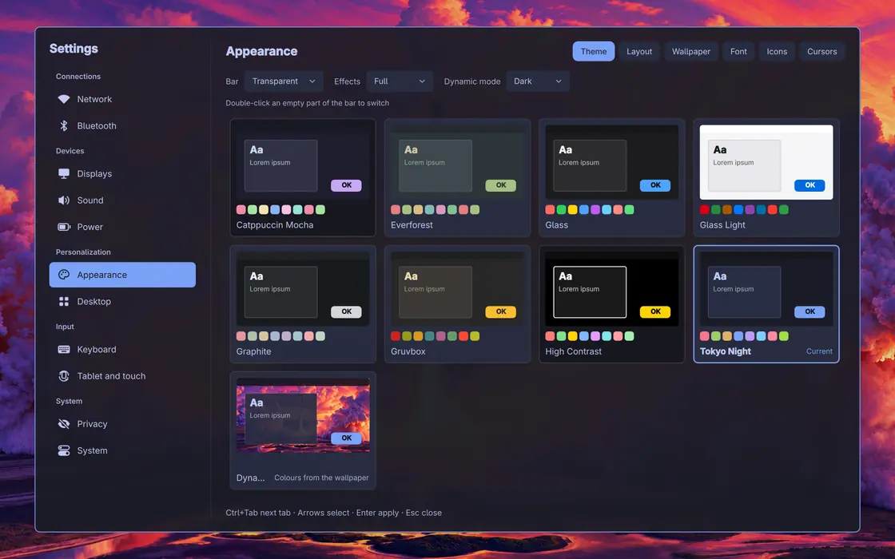
</p>

`Super + I` opens one Settings panel for network, Bluetooth, displays, sound, power, appearance, the desktop, the AI assistant, keyboard, tablet and privacy. Its **System** section looks after the system with no terminal: it checks for updates and applies them, adds and removes [installer profiles](docs/guide/installation.md#profiles-in-settings) and rebuilds the [Hyprland plugins](docs/guide/plugins.md), in the background, behind one prompt. That prompt is the shell's own Polkit agent: on a machine with a fingerprint reader it asks for the fingerprint first, and **Use password** is one tap away.

### An installer in profiles

| | |
| --- | --- |
| 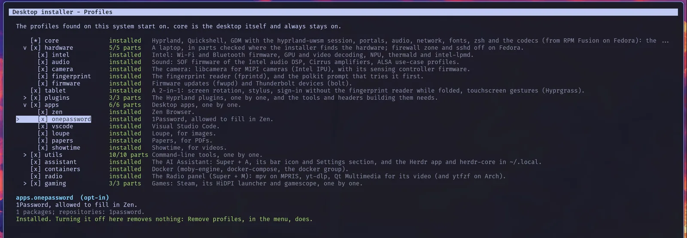 | 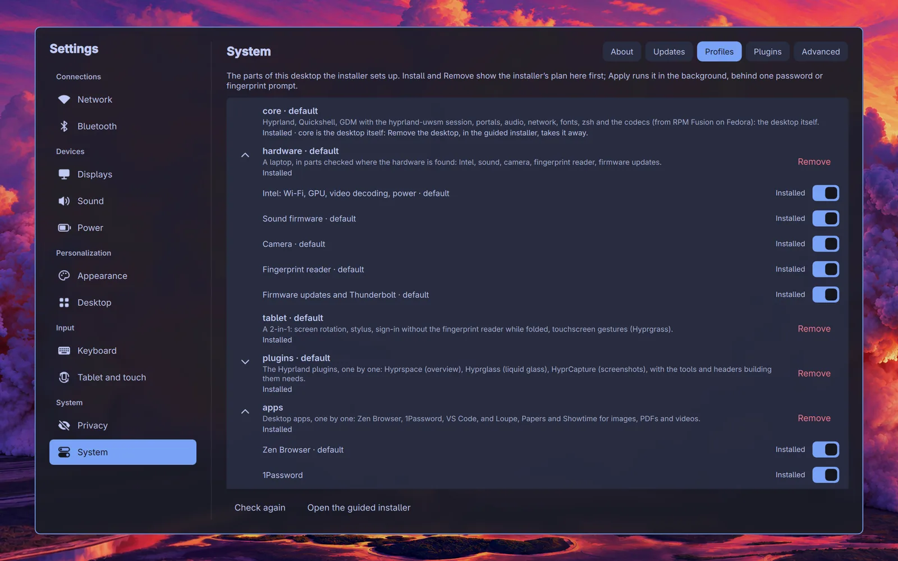 |
| **Guided installer.** Pick profiles and parts, review every change, then apply. | **Profiles in Settings.** Add or remove them later, part by part. |

The [installer](docs/guide/installation.md) comes in profiles: `core` is the desktop itself, then `hardware`, `tablet`, `plugins`, `apps`, `utils`, `assistant`, `containers`, `radio` and `gaming`, each yours to take or leave. Profiles with parts let you pick them one by one: the hardware this machine has, each Hyprland plugin, each app and command-line tool, Steam and gamescope. What a missing part or profile drives, such as a plugin's shortcuts or the whole AI block, is hidden. The same tool [checks for updates](docs/guide/installation.md#checking-for-updates): system packages, pinned plugins and, on Arch, AUR packages.

### And the rest

| | |
| --- | --- |
| 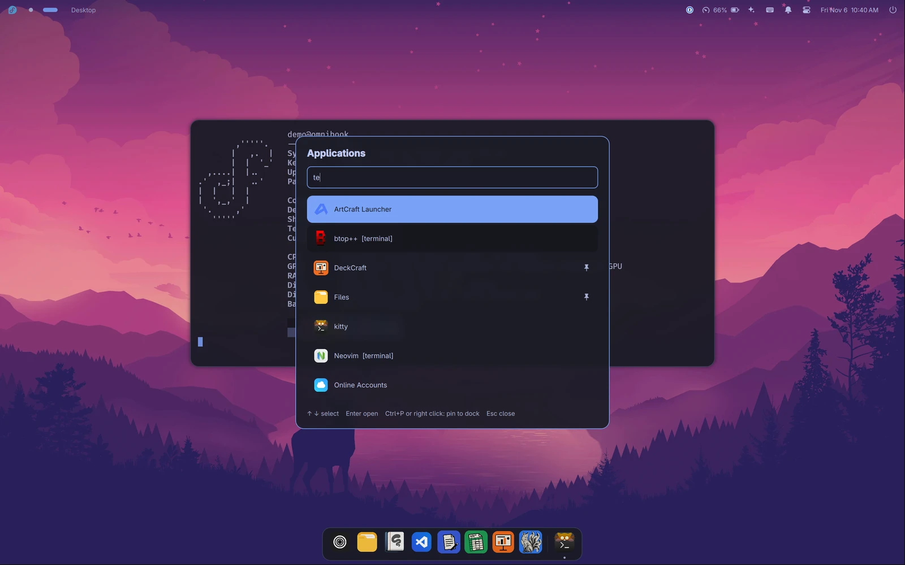 | 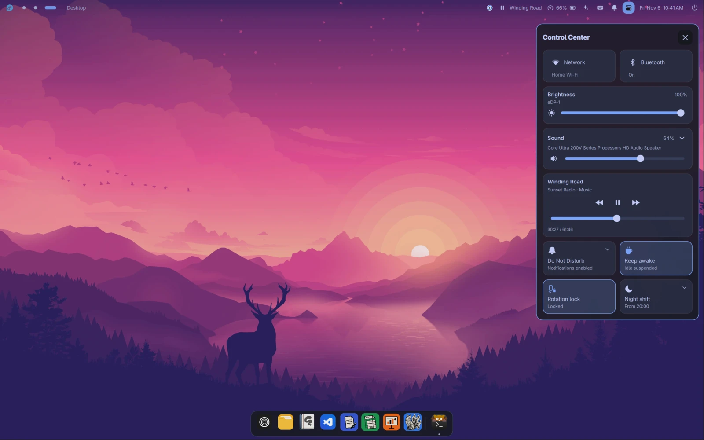 |
| **Launcher.** Apps as you type, then files, sums and unit conversions. | **Control Center.** Network, audio, brightness, media and switches. |
| 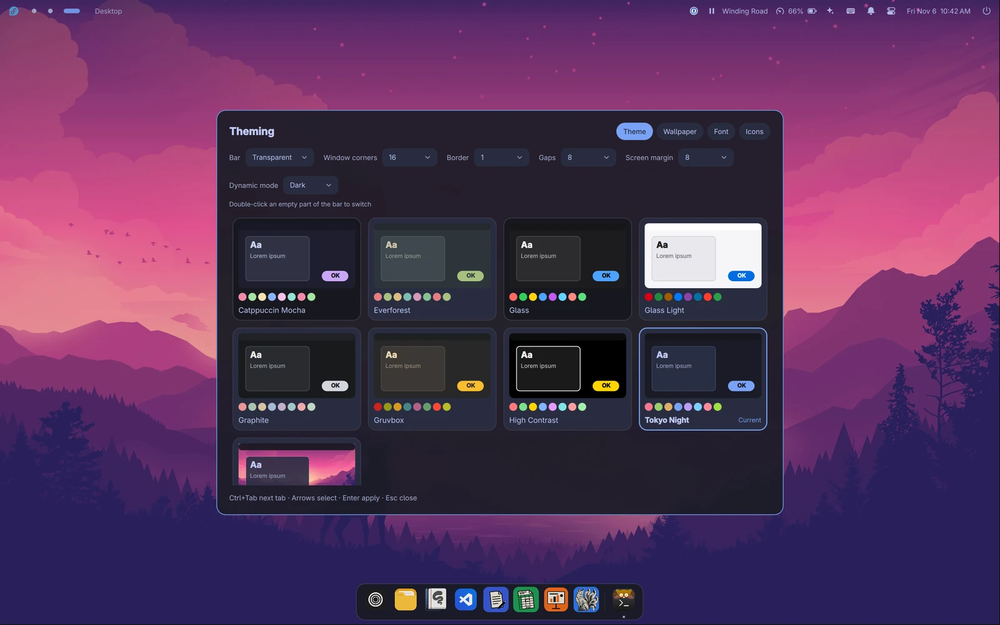 | 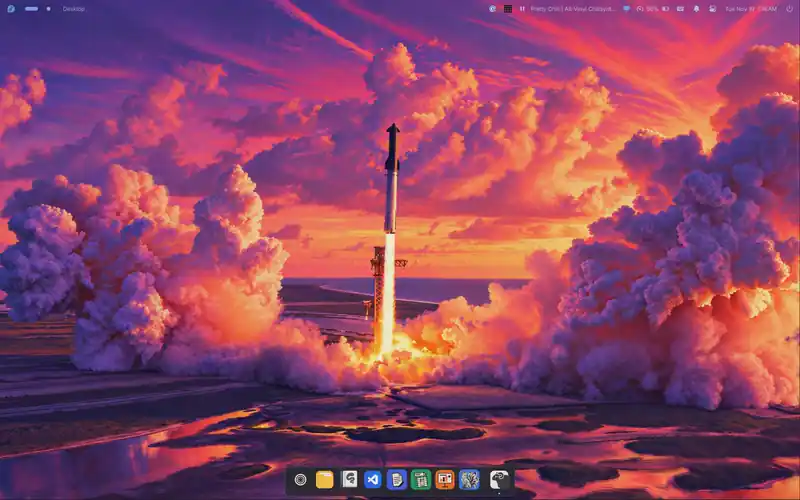 |
| **[Themes that reach everything](docs/features/theming.md).** Shell, terminal, GTK and Qt apps, lock screen, wallpapers, fonts and icons in one click: eight themes, liquid Glass and High Contrast among them, plus one drawn from your wallpaper, and cursor and icon themes from the KDE Store. | **[Radio and music](docs/features/radio.md).** `Super + M`: web radio stations and vinyl DJ sets, YouTube mixes and playlists found as you type, and the ones you save. The sound plays in an mpv of its own, on MPRIS like any other player, and the video, when you want it, in the panel. |
| 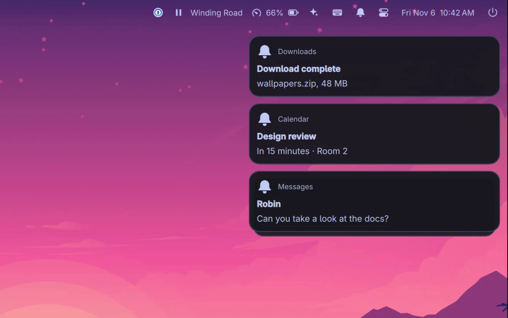 | 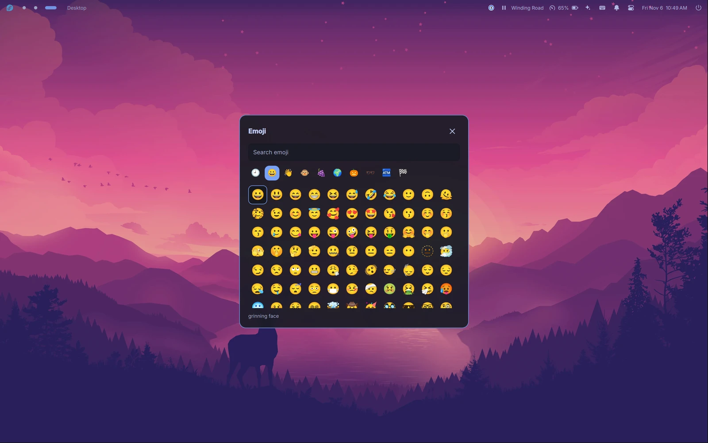 |
| **[Notifications in decks](docs/features/notifications.md).** One deck per app, or per site for browsers, opened on hover or tap. | **Emoji.** Search by name or browse by group, and paste into the focused window. |
| 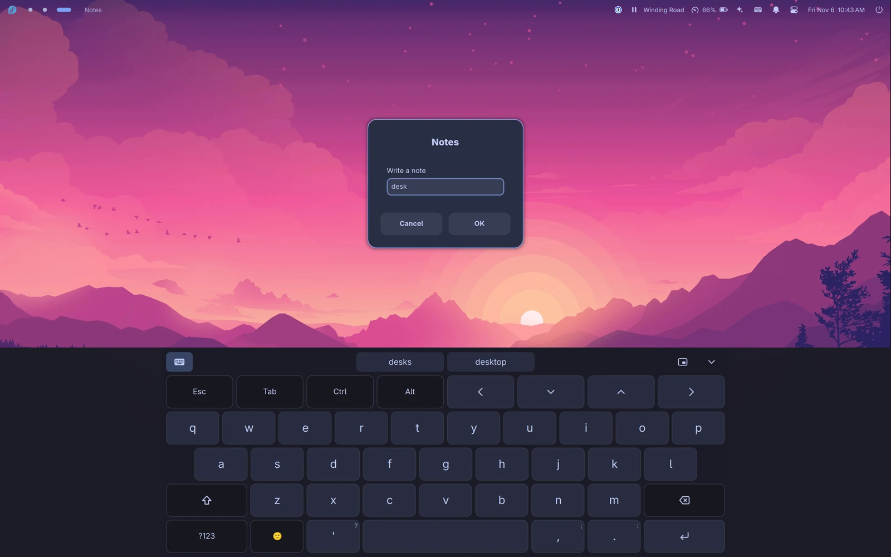 | 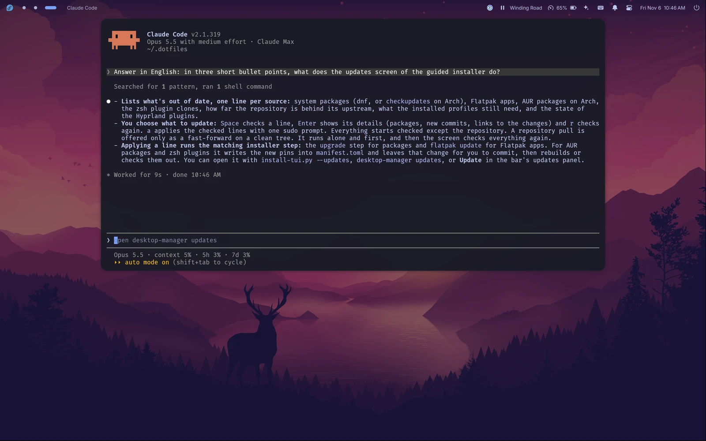 |
| **[On-screen keyboard](docs/features/on-screen-keyboard.md).** Slide between keys, hit likely letters more easily, tap suggestions in Italian and English. It learns your words, and nothing you type leaves the machine. | **[AI console](docs/features/ai-assistant.md).** Claude Code, Codex or any coding agent dropping down from the bar in the Herdr app, with a state icon, usage meters and a notification when it needs you. |

- **[A real tablet mode](docs/features/tablet-and-touch.md).** Fold the laptop and the shell grows its touch targets, the display follows the sensor, and gestures take over. Gesture touches never reach the app underneath, so a swipe over a video does not pause it.
- **The small things.** Italian and English everywhere, Alt + Tab, per-app volume, a color picker and text from the screen, a camera and microphone indicator, Steam and gamescope launchers tuned for HiDPI, automounted drives, fingerprint unlock.

The animation at the top cycles through the themes; the other pictures use the Tokyo Night theme.

## Getting started

> [!NOTE]
> This is a personal desktop, tuned for Fedora and an HP OmniBook Ultra Flip. It should work on other hardware, with some settings to adjust. The installer also supports Arch Linux, so far tested in containers only; other distributions are on the [roadmap](docs/development/roadmap.md).

On a fresh Fedora 45, Server edition included, or a base Arch Linux, one script installs everything:

```sh
sudo dnf install -y git-core python3      # Fedora
sudo pacman -S --needed git python        # Arch
git clone https://github.com/angelobdev/dotfiles ~/.dotfiles
cd ~/.dotfiles
./scripts/install-tui.py              # guided: choose, review, then apply
```

Without the guided installer, `./scripts/install-desktop.py` previews the changes and `./scripts/install-desktop.py apply` makes them.

At the first login a terminal opens and builds the [Hyprland plugins](docs/guide/plugins.md). Everything is a symlink to this repository, so editing a file here changes the live desktop. The [installation guide](docs/guide/installation.md) covers the profiles and what the script does.

## Documentation

- **[Guides](docs/README.md#guides):** installation, interface and shortcuts, configuration, plugins, integrations, troubleshooting.
- **[Features](docs/README.md#features):** one page for each area of the desktop.
- **[Development](docs/README.md#development):** architecture, conventions, workflow, roadmap and the verification log.
- **[Issues](https://github.com/angelobdev/dotfiles/issues/new/choose):** bug reports, feature requests and enhancements, each with its own form.

## Built with

[Hyprland](https://hypr.land/), [Quickshell](https://quickshell.org/) and GNU Stow, with [Hyprspace](https://github.com/KZDKM/Hyprspace), [Hyprgrass](https://github.com/horriblename/hyprgrass), [Hyprglass](https://github.com/hyprnux/hyprglass) and [HyprCapture](https://github.com/gfhdhytghd/HyprCapture). The default wallpaper is Fedora's night artwork ([CC-BY-SA-4.0](hyprpaper/.local/share/wallpapers/ATTRIBUTION.md)). Theme wallpapers come from [Omarchy](https://github.com/basecamp/omarchy) and community collections, and word lists from [FrequencyWords](https://github.com/hermitdave/FrequencyWords) (CC-BY-SA-4.0): both are fetched on demand and are not part of this repository.

Much of this desktop was built together with [Claude Code](https://claude.com/claude-code), and the [verification log](docs/development/verification-log.md) records what was tested and how.

## License

[MIT](LICENSE), except the bundled wallpaper, which keeps its [own license](hyprpaper/.local/share/wallpapers/LICENSE).
